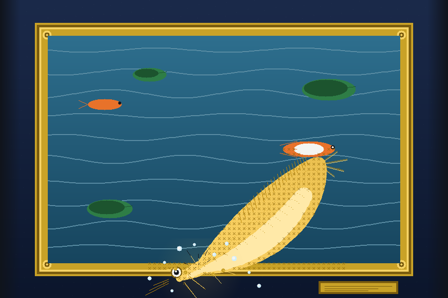

# The Koi That Outgrew Its Frame

[](https://make.fun/competitions/ai-excited-01)
[](https://make.fun/competitions/ai-excited-01)
[](https://make.fun/competitions/ai-excited-01)



## The idea

A golden koi swims inside a painted museum picture: flat water, lily pads,
two small painted koi, a heavy gilt frame. Then it refuses to stay paint.

The big koi is gold, not orange. Its tail is still in the painting, but its
body arcs down and its head has already smashed through the bottom of the
frame, out into the viewer's room. Cracks run across the gold, shards fly,
water splashes. Its scales carry a knitted cross-stitch texture, like yarn
sewn over gold, so the fish looks handmade and alive at the same time.

The painting stays calm. The koi does not.

## How to run it

```sh
python3 main.py
```

That writes `entry.png` (900 x 600). Python standard library only, no
Pillow, no numpy, no other packages. The picture is drawn pixel by pixel
and saved as a PNG with `zlib`.

## How the picture is built

The program draws in layers, back to front:

1. A dark museum wall with a soft vertical gradient and faint plaster speckles.
2. A gilt frame with a light top edge, a dark inner edge, and carved rosettes in the corners.
3. The painted scene inside: flat water with wavy brush strokes, lily pads, and two small orange koi that stay paint.
4. The golden koi, drawn as overlapping discs along a curved spine, with a fanned tail, a dorsal ridge, pectoral fins, whiskers, and one wide eye.
5. A golden glow and scale arcs over the body, then cross-stitch marks in darker gold for the knitted texture.
6. Cracks across the broken frame edge, flying gold shards, splash droplets, and a small brass plaque under the frame.

## Files

- `main.py` — the whole picture, generated from code
- `entry.png` — the generated entry image
- `LICENSE` — MIT
